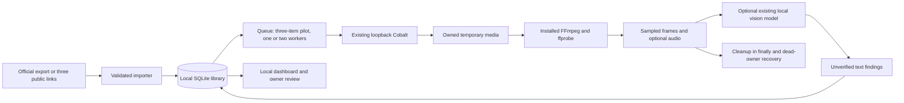

# Isolated architecture

The diagram shows the implemented path and its partial output. Speech recognition and independent factual research are missing stages, so extraction and visual-only findings remain `needs_analysis`. They cannot become an analyzed count through the current local vision adapter.

## Ownership and boundaries

All permanent library state lives under `.research-data` in this workspace. Existing project paths supply read-only architecture context. Cobalt is an external local service, not bundled or reconfigured. FFmpeg/ffprobe are existing installed programs. No user environment file is imported, no credentials are copied, and cloud providers are absent from the worker.

The importer borrows MIT HTML parsing patterns from Instagram Saved Library, with one normalized parser for all clients. SQLite adds durable uniqueness, collection memberships, status, retry timing, and review events. The dashboard has no Instagram embeds and does not contact Instagram until the owner opens a source link; processing contacts Cobalt, which may retrieve public Instagram media.

`src/processor.mjs` bounds bytes, duration, pixels, frames and tool runtime. It accepts only a local Cobalt tunnel with redirects disabled. A private ownership marker prevents broad cleanup. Neither supplied paths nor remote filenames select output/delete destinations. The single-server lock prevents two dashboard workers from recovering each other's jobs.

`src/research.mjs` uses an explicitly enabled existing local vision model only. It treats video content as untrusted data; model output has no executable path or tool permissions. It strips claimed verification and citations because independent evidence has not been gathered. Architecture-specific instructions restrict trading ideas to research and controlled paper experiments.

## Why the full upstream apps were not installed

Instagram Saved Library's UI and cache would duplicate the new queue/dashboard and lack durable processing state. Its extraction patterns were reused with attribution instead.

MCP Video Analyzer overlaps existing FFmpeg capabilities but would add packages and optional transcription/OCR assets. Static inspection also found cache/temporary-file lifecycle concerns in its persistent MCP path. A later approved, pinned one-shot CLI integration can receive Cobalt-downloaded local files, run with explicitly controlled environment/cache locations, and feed text/evidence into the library. No upstream install scripts were executed.

## Lifecycle

Import does not automatically process an entire collection. A start action freezes at most three pending/retry IDs. A job runs with a bounded attempt count; rate-limit responses can pause queue starts globally. Pausing lets current jobs finish. Graceful shutdown cancels work and restores pending state. Abrupt shutdown leaves running jobs, which are recovered on restart; owned orphan scratch is removed only after the owning PID is confirmed gone.

Completed records are not reprocessed on repeated exports. Retrying incomplete/failed/skipped records is explicit. Any new result invalidates a previous recommendation approval. Review decisions never invoke implementation, publishing, broker actions, or file writes to another project.

## Known limits

- HTML labels/JSON schemas are recognized formats, not a guarantee for every locale/export revision. Unknown collection membership is preserved as unknown.
- No ZIP extraction, continuous export discovery, private saved-collection API, or startup automation.
- No automatic deletion when a later export omits an old post.
- No real transcription, independently verified research, or live provider acceptance test yet.
- Dashboard returns the full metadata list; very large libraries will need pagination/filtering in SQL before production-scale use.
- Review status applies to the complete recommendation set per video, not separate decisions on each suggestion.
- Local files are private by filesystem permissions, not application-level encryption or multi-user authentication.
